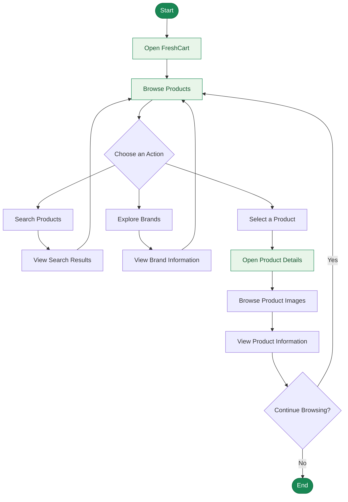

<div align="center">

# 🛒 FreshCart
### E-Commerce Web Application

**ITI Graduation Project | Front-End Development**

A modern e-commerce application that provides a simple and intuitive shopping experience through product browsing, brand exploration, and detailed product pages.

<br>


<br>

[Repository](https://github.com/Joseph-Mohamed/Freshcart-Graduation_Project_ITI-)
·
[Report an Issue](https://github.com/Joseph-Mohamed/Freshcart-Graduation_Project_ITI-/issues)

</div>

---

## 📑 Table of Contents

- [📌 Project Overview](#-project-overview)
- [✨ Features](#-features)
- [🖥️ Screenshots](#️-screenshots)
- [🛠️ Technologies](#️-technologies)
- [🔄 Application Flowchart](#-application-flowchart)
- [⚙️ Prerequisites](#️-prerequisites)
- [🚀 Installation & Setup](#-installation--setup)
- [📂 Project Structure](#-project-structure)
- [🎯 Learning Objectives](#-learning-objectives)
- [🔮 Future Improvements](#-future-improvements)
- [🎓 Acknowledgments](#-acknowledgments)

---

## 📌 Project Overview

**FreshCart** is an e-commerce web application developed as part of an **Information Technology Institute (ITI) graduation project**.

The application provides an intuitive shopping interface that allows users to explore products, search for items, discover brands, and view detailed product information.

The project focuses on building a responsive user interface while applying modern front-end development concepts and component-based architecture.

### 🎯 Project Goals

- Build a clean and user-friendly shopping experience.
- Organize products into an accessible interface.
- Enable convenient product and brand exploration.
- Create responsive layouts for different screen sizes.
- Apply React and modern JavaScript concepts in a real-world project.

---

## ✨ Features

### 🛍️ Product Browsing
- Browse available products through an organized product grid.
- View product images, names, categories, prices, and ratings where available.
- Navigate to individual product details.

### 🔎 Product Search
- Search for products by name.
- Find products more conveniently through the search interface.

### 🏷️ Brand Exploration
- Browse brands through a dedicated brands page.
- Explore brand information and available products where supported.

### 🖼️ Product Details
- View detailed product information.
- Browse product images through an image gallery.
- Access available product information and ratings.

### 📱 Responsive UI
- Organized layouts for different screen sizes.
- Bootstrap-based styling and layout utilities.
- Consistent navigation and visual presentation.

### ⚡ Interactive Navigation
- Navigate between application pages.
- Explore products and brands through an intuitive interface.

---

## 🖥️ Screenshots

Explore the main interfaces of FreshCart.

> **Note:** Upload the screenshots into the `screenshots/` folder in the repository root. Use the exact filenames shown below.

### 🏠 Home Page

Browse the available products through a clean and organized home.

<div align="center">


</div>

### 🛍️ Product Recommendations

Explore recommended products and use the search interface to find items.

<div align="center">


</div>

### 🏷️ All Brands

Discover brands through a dedicated and organized interface.

<div align="center">


</div>

### 📦 Product Details

View product information, browse available images, and explore the product page.

<div align="center">


</div>

### 🏢 Brand Details

View the information presented for an individual brand.

<div align="center">


</div>

---

## 🛠️ Technologies

| Technology | Purpose |
|---|---|
| **HTML5** | Structures the application's content. |
| **CSS3** | Provides styling and visual presentation. |
| **JavaScript ES6+** | Implements application logic and interactive behavior. |
| **React.js** | Builds reusable, component-based user interfaces. |
| **React Router** | Supports client-side navigation, if configured in the project. |
| **Bootstrap 5** | Provides responsive layout utilities and styling. |
| **Font Awesome** | Provides icons, where used. |
| **Swiper.js** | Supports sliders and image galleries, where used. |
| **Git & GitHub** | Support version control and collaboration. |

---

## 🔄 Application Flowchart

The following diagram illustrates the main browsing journey through FreshCart.



---

## ⚙️ Prerequisites

Before running FreshCart locally, make sure you have installed:

- **Node.js** — JavaScript runtime.
- **npm** — Package manager included with Node.js.
- **Git** — Version control system.
- **Visual Studio Code** or another code editor.

Official resources:

- [Download Node.js](https://nodejs.org/)
- [Download Git](https://git-scm.com/)
- [Visual Studio Code](https://code.visualstudio.com/)

---

## 🚀 Installation & Setup

Follow these steps to run FreshCart on your local machine.

### 1. Clone the Repository

```bash
git clone https://github.com/Joseph-Mohamed/Freshcart-Graduation_Project_ITI-.git
```

### 2. Navigate to the Project Directory

```bash
cd Freshcart-Graduation_Project_ITI-
```

### 3. Navigate to the Application Folder

```bash
cd Freshcart
```

### 4. Install Dependencies

```bash
npm install
```

### 5. Start the Development Server

Check the `scripts` section in `package.json` and execute the appropriate command.

For a Create React App project:

```bash
npm start
```

For a Vite project:

```bash
npm run dev
```

> Use the command configured in your project. You do not need to run both commands.

### 6. Open the Application

Open the local URL displayed in your terminal.

Common development URLs are:

- Create React App: `http://localhost:3000`
- Vite: `http://localhost:5173`

The actual URL depends on your project configuration.

---

## 📂 Project Structure

The following structure illustrates how the repository and screenshots can be organized.

```text
Freshcart-Graduation_Project_ITI-/
│
├── Freshcart/
│   ├── public/
│   ├── src/
│   ├── package.json
│   └── package-lock.json
│
├── screenshots/
│   ├── home.png
│   ├── products.png
│   ├── brands.png
│   ├── product-details.png
│   └── brand-details.png
│  
│
└── README.md
```

> The application folders shown above are illustrative. Your actual source-code structure may differ.

---

## 🎯 Learning Objectives

Through this project, we practiced:

- Building React applications using reusable components.
- Applying modern JavaScript features.
- Creating responsive interfaces with Bootstrap.
- Organizing and displaying product data.
- Implementing product search functionality.
- Designing interactive product pages.
- Navigating between application views.
- Managing source code using Git and GitHub.
- Writing clear project documentation.

---

## 🔮 Future Improvements

Potential enhancements include:

- 🛒 Shopping cart management.
- ❤️ Wishlist functionality.
- 🔐 User authentication and account management.
- 📦 Order management and order history.
- 💳 Payment integration.
- 🔎 Advanced filtering and sorting.
- 🧪 Automated testing.
- ♿ Improved accessibility.
- 🚀 Production deployment and performance optimization.

> These are potential future enhancements and are not necessarily implemented in the current version.

---

## 🎓 Acknowledgments

This project was developed as part of the **Information Technology Institute (ITI)** training program.

Special thanks to the instructors, mentors, and everyone who contributed to the learning experience and project development.

---

<div align="center">

## 🛒 FreshCart

**Making online shopping simple and intuitive.**

Developed with ❤️ as an ITI Graduation Project.

[⬆ Back to Top](#-freshcart)

</div>
