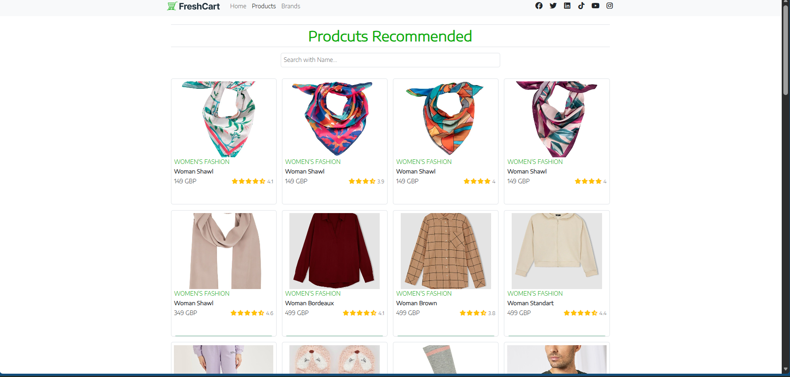
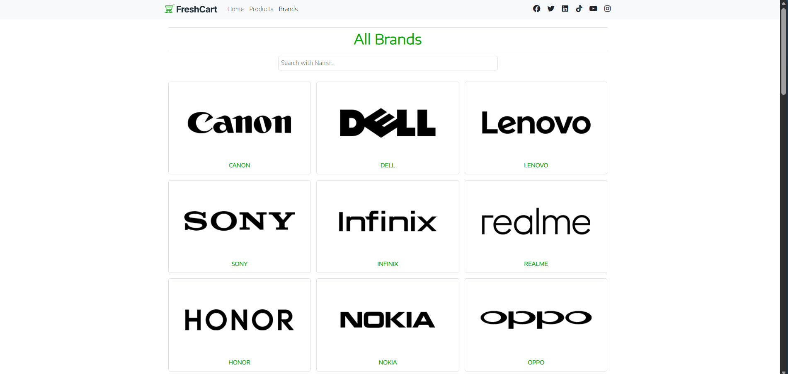
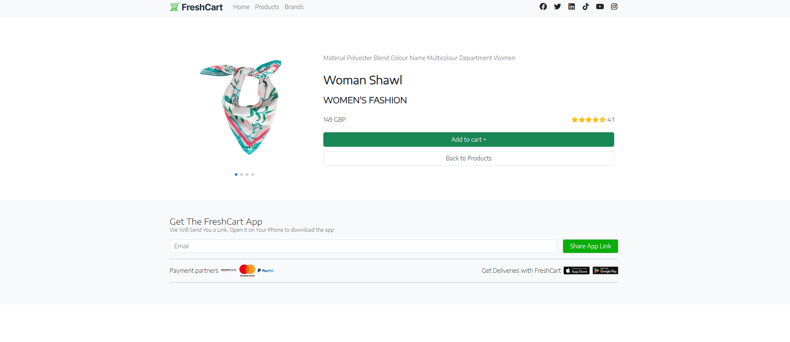
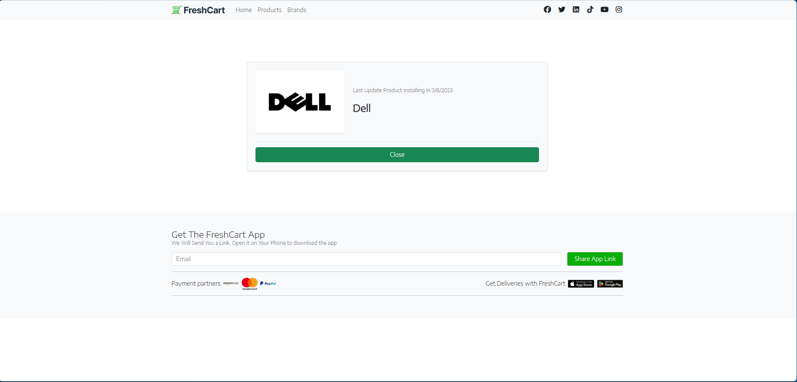

<div align="center">

# 🛒 FreshCart
### Modern E-Commerce Web Application

**ITI Graduation Project | Front-End Development**

A responsive e-commerce application designed to provide users with a simple, intuitive, and engaging online shopping experience.

<br />


<br />

[Explore Repository](https://github.com/Joseph-Mohamed/Freshcart-Graduation_Project_ITI-)
·
[Report an Issue](https://github.com/Joseph-Mohamed/Freshcart-Graduation_Project_ITI-/issues)

</div>

---

## 📑 Table of Contents

- [📌 Project Overview](#-project-overview)
- [✨ Key Features](#-key-features)
- [🖥️ Application Screenshots](#️-application-screenshots)
- [🛠️ Technology Stack](#️-technology-stack)
- [🔄 Application Flowchart](#-application-flowchart)
- [⚙️ Prerequisites](#️-prerequisites)
- [🚀 Installation & Setup](#-installation--setup)
- [📂 Project Structure](#-project-structure)
- [🎯 Learning Objectives](#-learning-objectives)
- [🔮 Future Improvements](#-future-improvements)
- [🎓 Acknowledgments](#-acknowledgments)

---

## 📌 Project Overview

**FreshCart** is an e-commerce web application developed as part of an Information Technology Institute (ITI) graduation project.

The application provides an organized shopping interface where users can explore products, search for items, discover brands, and view detailed product information through an intuitive and responsive user interface.

The project focuses on applying modern front-end development practices, reusable React components, client-side navigation, and responsive UI design.

### 🎯 Project Goals

- Build a clean and user-friendly shopping interface.
- Organize product information for easy browsing.
- Provide interactive product and brand exploration.
- Implement responsive layouts for different screen sizes.
- Apply React and modern JavaScript concepts in a practical project.

---

## ✨ Key Features

### 🛍️ Product Browsing

- Explore a collection of products through an organized product listing.
- View product images, names, categories, prices, and ratings where available.
- Navigate between product listings and product details.

### 🔎 Product Search

- Search for products by name.
- Filter displayed products based on the search input.

### 🏷️ Brand Exploration

- Explore available brands through a dedicated brands section.
- View brand information and associated products where supported.

### 🖼️ Product Details

- View detailed product information.
- Browse product images through an interactive image gallery.
- Explore available product information and ratings.

### 📱 Responsive User Interface

- Responsive layouts designed for different screen sizes.
- Bootstrap-based layout and styling.
- Consistent navigation and visual elements.

### ⚡ Client-Side Navigation

- Navigate between application pages using React Router.
- Provide a smooth browsing experience without requiring a full page reload for every navigation.

---

## 🖥️ Application Screenshots

The following screenshots demonstrate the application's main interfaces.

> **Note:** Add the individual screenshot files to `Freshcart/screenshots/` using the filenames shown below. Each image will appear separately.

### 🏠 Products & Recommendations

Explore products through a clean layout featuring product cards, ratings, and search functionality.

<div align="center">
  
</div>

### 🏷️ All Brands

Discover available brands through a dedicated, organized brand listing.

<div align="center">
  
</div>

### 🛍️ Product Details

View product information, explore the product gallery, and access available product actions.

<div align="center">
  
</div>

### 🏷️ Brand Details

View the information displayed for a selected brand.

<div align="center">
  
</div>

---

## 🛠️ Technology Stack

The application uses modern front-end technologies to build its interface and application structure.

| Technology | Purpose |
|---|---|
| **HTML5** | Structures the application's content. |
| **CSS3** | Provides custom styling and visual presentation. |
| **JavaScript ES6+** | Implements application logic and interactive behavior. |
| **React.js** | Builds reusable, component-based user interfaces. |
| **React Router** | Supports client-side navigation between pages. |
| **Bootstrap 5** | Provides responsive layout utilities and UI styling. |
| **Font Awesome** | Provides icons used throughout the interface. |
| **Swiper.js** | Supports interactive image galleries and sliders where implemented. |
| **Git & GitHub** | Support source-code version control and collaboration. |

---

## 🔄 Application Flowchart

The following flowchart illustrates the main browsing journey through FreshCart.


---

## ⚙️ Prerequisites

Before running FreshCart locally, ensure that the following tools are installed.

| Requirement | Description |
|---|---|
| **Node.js** | JavaScript runtime environment. |
| **npm** | Package manager included with Node.js. |
| **Git** | Required to clone the repository. |
| **Code Editor** | Visual Studio Code or any preferred editor. |

You can download the required tools from their official websites:

- [Node.js](https://nodejs.org/)
- [Git](https://git-scm.com/)
- [Visual Studio Code](https://code.visualstudio.com/)

---

## 🚀 Installation & Setup

Follow these steps to clone the repository, install the dependencies, and run FreshCart locally.

### 1. Clone the Repository

Open your terminal and execute:

```bash
git clone https://github.com/Joseph-Mohamed/Freshcart-Graduation_Project_ITI-.git
```

### 2. Navigate to the Project Directory

```bash
cd Freshcart-Graduation_Project_ITI-
```

### 3. Navigate to the Application Folder

The application is located inside the `Freshcart` directory.

```bash
cd Freshcart
```

### 4. Install Dependencies

Install the project's required packages:

```bash
npm install
```

### 5. Start the Development Server

Run the appropriate command according to the scripts defined in `package.json`.

For a Create React App project:

```bash
npm start
```

For a Vite project:

```bash
npm run dev
```

**Important:** Use the command configured in your project's `package.json`. The commands above are alternatives, not commands that must both be executed.

### 6. Open the Application

Once the development server starts, open the local URL displayed in your terminal.

Common development URLs include:

- Create React App: `http://localhost:3000`
- Vite: `http://localhost:5173`

The actual URL depends on your project configuration.

---

## 📂 Project Structure

The repository contains the main application inside the `Freshcart/` directory.

```text
Freshcart-Graduation_Project_ITI-/
│
├── Freshcart/
│   ├── public/                 # Public static assets
│   ├── src/                    # Application source code
│   │   ├── components/         # Reusable UI components
│   │   ├── pages/              # Application pages
│   │   ├── assets/             # Images and other assets
│   │   └── ...                 # Other application modules
│   │
│   ├── screenshots/            # README application screenshots
│   ├── package.json            # Dependencies and npm scripts
│   └── package-lock.json       # Dependency lock file
│
└── README.md                   # Project documentation
```

> The structure above is illustrative. Folder names may differ from the actual implementation.

---

## 🎯 Learning Objectives

This project provides practical experience with:

- Building component-based applications using React.
- Applying modern JavaScript features.
- Creating responsive layouts with Bootstrap.
- Implementing client-side navigation.
- Rendering and filtering product data.
- Designing interactive product interfaces.
- Organizing source code for maintainability.
- Using Git and GitHub for version control.
- Documenting a software project professionally.

---

## 🔮 Future Improvements

Potential enhancements for future versions include:

- 🛒 Shopping cart management.
- ❤️ Wishlist functionality.
- 🔐 User authentication and account management.
- 📦 Order management and order history.
- 💳 Payment integration.
- 🔎 Advanced product filtering and sorting.
- 🧪 Automated testing.
- ♿ Improved accessibility.
- 🚀 Production deployment and performance optimization.

> These items represent potential improvements and should not be interpreted as currently implemented features.

---

## 🎓 Acknowledgments

This project was developed as part of the **Information Technology Institute (ITI)** training program.

Special thanks to the instructors, mentors, and everyone who contributed to the learning experience and project development.

---

<div align="center">

### 🛒 FreshCart

**Making online shopping simple and intuitive.**

Developed with ❤️ as an ITI Graduation Project.

[⬆ Back to Top](#-freshcart)

</div>
